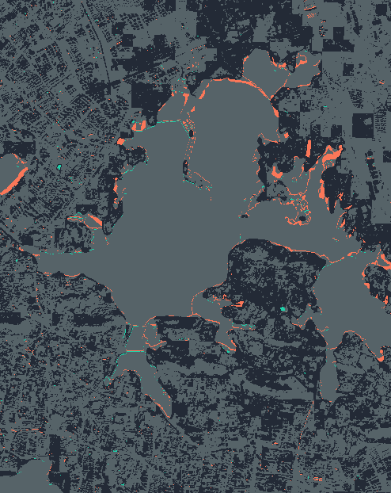

# LakeWatch

**真实 Sentinel-2 像元驱动的水域变化观测工作台。** 固定研究窗口、明确质量掩膜、两期共同有效范围、参数敏感性及完整来源记录。

[在线观测台](https://clnay5.github.io/lakewatch/) · [方法与限制](docs/method.md) · [真实结果](docs/results/results.json) · [来源清单](data/manifest.json)



## 已实现

- STAC 完整分页查询、几何覆盖检查、场景云量排序及窗口有效覆盖门槛。
- HTTPS Range 读取真实 COG 局部块；校验 Content-Range，保留 TLS 校验和有限块缓存。
- 绿光 / SWIR16 / SCL 同网格处理；显式反射率缩放、nodata、20 m UTM 面积。
- MNDWI 固定阈值、四档敏感性、Otsu 诊断；时序仅比较有效掩膜交集。
- 水域增减 GeoJSON、分类图、栅格与矢量面积交叉核对、版本和数组哈希。
- 两处武汉湖区窗口、两次 2021 年实测影像的可重跑案例。不是当前湖泊状况。

## 运行

Python 3.11+：

```bash
python -m venv .venv
# Windows: .venv\Scripts\activate
# Linux/macOS: source .venv/bin/activate
python -m pip install -e ".[test]"
python -m pytest -q
python -m lakewatch.pipeline --pinned
python scripts/verify_real.py
python -m http.server 4175 --directory docs
```

`--pinned` 从已提交 manifest 获取确切场景；不加该参数会重新搜索。首次联网读取 COG 子块，可能耗时数分钟。缓存和本地 GeoTIFF 留在 `data/cache`，不提交大幅源影像。修改 config 会使缓存失效。没有收费 API 或密钥。

## 实际案例与解释边界

2021‑02‑18 → 2021‑09‑21；默认 MNDWI >0：

| 研究窗口 | 共同有效覆盖 | 前期观测水域 km² | 后期观测水域 km² | 净变化 km² |
|---|---:|---:|---:|---:|
| 东湖周边 | 67.10% | 31.8740 | 30.2256 | -1.6484 |
| 汤逊湖周边 | 65.95% | 44.2828 | 43.7368 | -0.5460 |

数值仅表示窗口内共同有效像元的分类面积，**不能当作整个湖泊的总面积或退水结论**。矩形内也包含其他水体。严格 SCL 策略剔除暗像元和未分类像元，会留下较大观测缺口。阈值敏感性显著，见在线表格。上述小数用于复算，展示时保留两位并不代表精度。

初始 2025 试算发现旧目录反射率偏移疑点；相关上游问题已有公开记录。首版限定处理基线 <04.00，拒绝猜测修正。这项限制和未来辐射核验方案见方法文档。

没有人工真值，因此不报告 IoU/F1 或虚构的“精度提升”。两期数据不能支持季节统计或因果解释。项目的真实亮点是完整的遥感处理、数据质量检查、复算链路与诚实的不确定性表达。

## 简历与面试

完成实际阅读、复跑并理解实现后，可以据实表述：

> 开发 LakeWatch 遥感水域观测工具，基于 STAC 与 COG 局部读取处理两个湖区的真实 Sentinel‑2 影像，实现波段对齐、云影掩膜、MNDWI 分类、共同有效范围变化统计及 GeoJSON 导出；用像元/矢量面积核对和参数敏感性分析保证结果可追溯。

实现过程使用 AI 辅助。MNDWI、Otsu、GDAL 重投影均为已有方法；未将上游项目换名冒充原创。面试应能解释 scale/offset、10 m 与 20 m 的差别、为什么不能直接相减两期不完整面积，以及没有真值时哪些结论不能下。

## 授权与来源

本项目自有代码 MIT，见 LICENSE。Sentinel‑2 源影像及派生展示须同时遵守 [Copernicus Sentinel 数据条款](https://dataspace.copernicus.eu/explore-data/data-collections/sentinel-data/sentinel-2)，来源：Copernicus Sentinel data (2021), accessed through Element 84 Earth Search / AWS Sentinel COGs。代码许可证不替代数据提供者条款。算法与依赖见方法文档及 pyproject；没有复制其它仓库代码。
